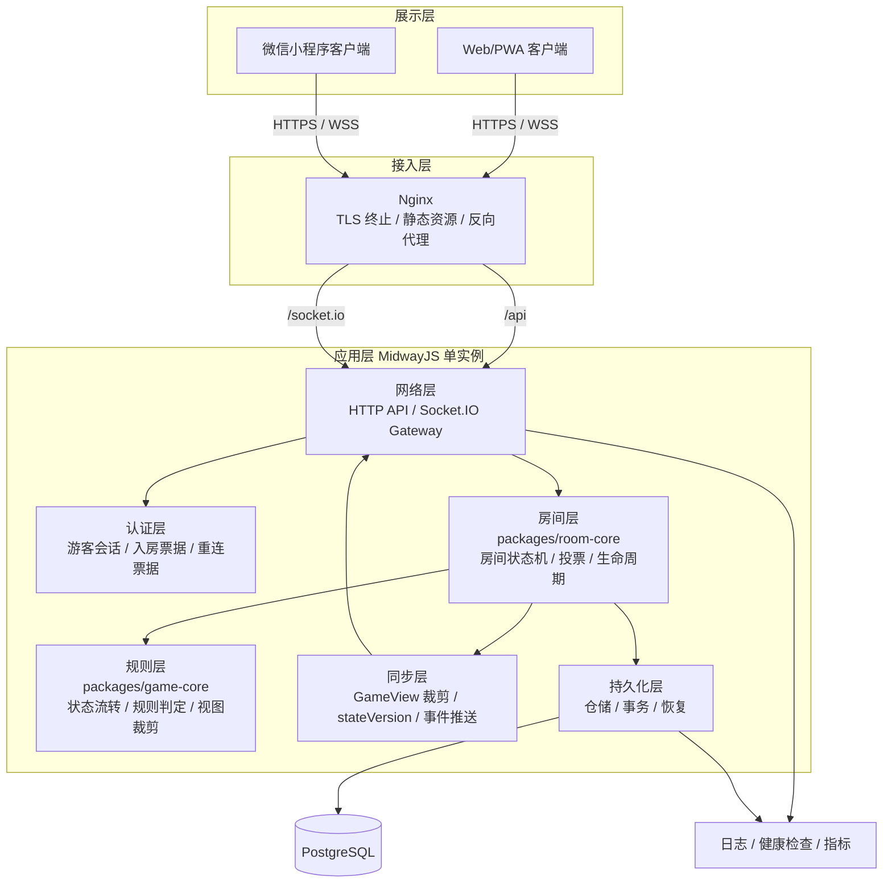
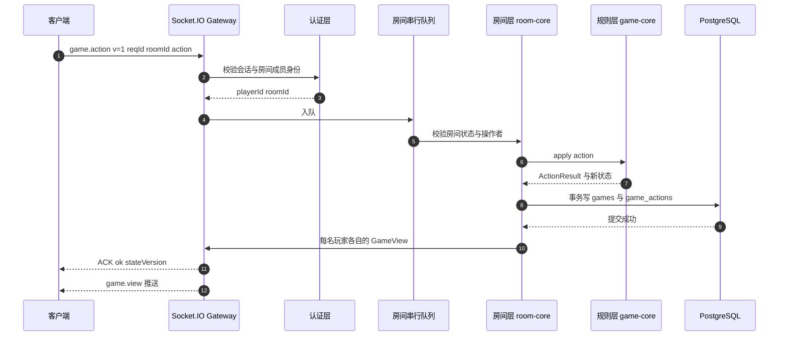
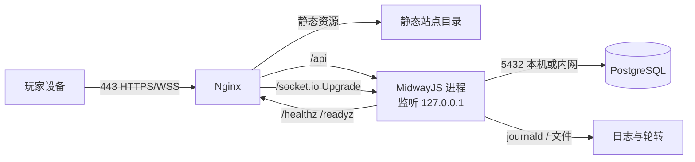
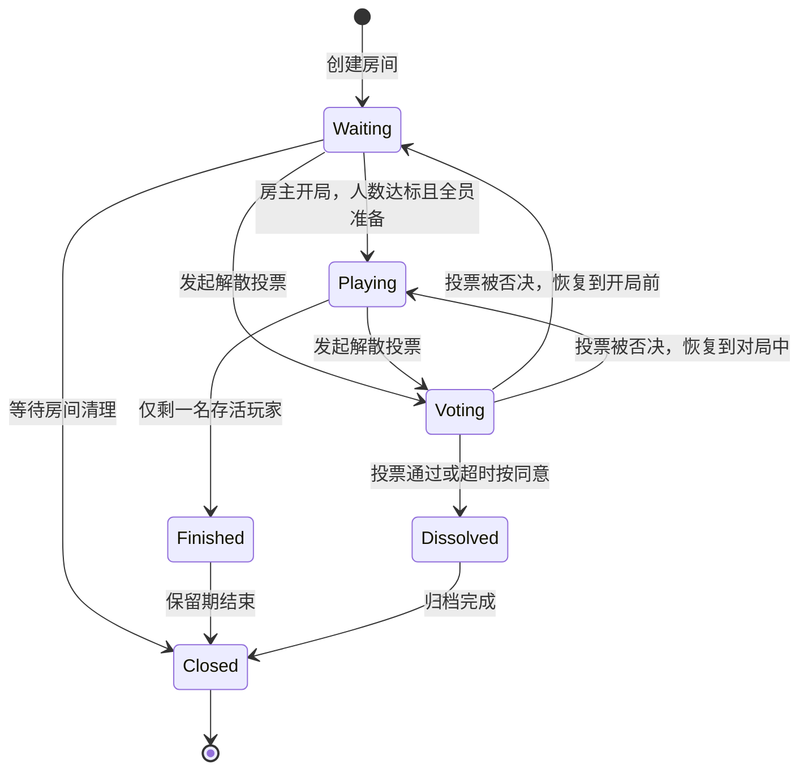
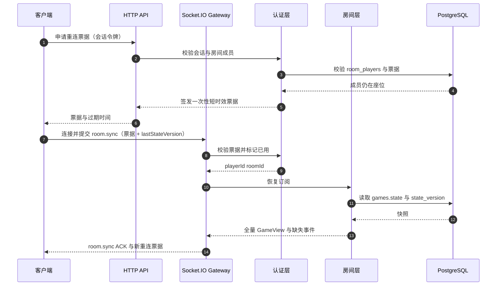
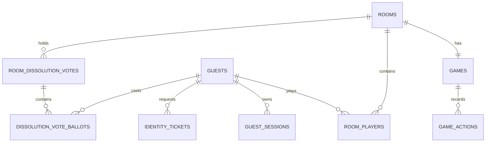
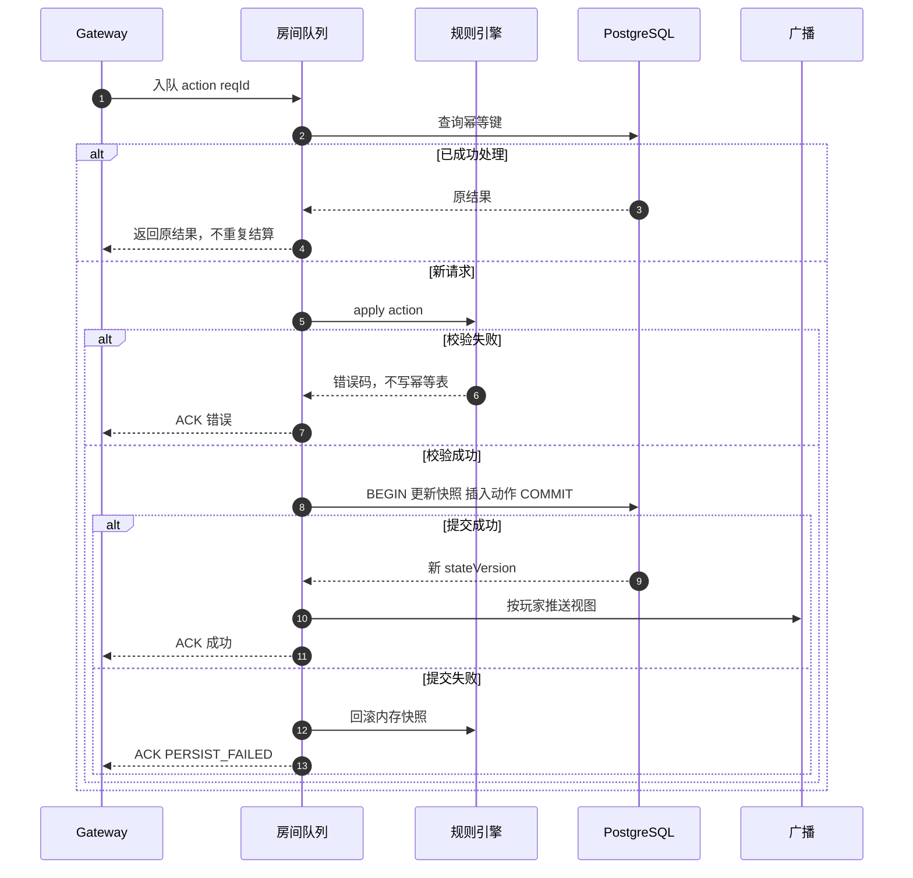
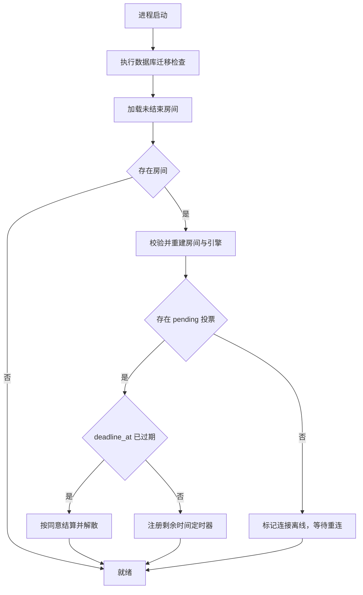

# 炸弹猫咪多人联机总体架构设计

- 文档版本：v1.0
- 编写日期：2026-11-26
- 设计阶段：第三阶段任务二（多人联机总体架构设计）
- 依据材料：`docs/08-多人联机/01-现有项目架构审计报告.md`、`docs/08-多人联机/02-多人联机产品决策记录.md`、根目录 `炸弹猫咪_规则.md`、`docs/04-产品设计/01-规则确认与线框图差异处理记录.md`、`AGENTS.md`、现有代码
- 文档性质：设计提案。已确认结论来自产品决策记录 D-01 至 D-14；本文件其余内容凡未标注「已确认」者，均为架构推荐，需评审或产品、运维、开发确认后方可实施。
- 边界声明：本任务只读代码与文档，只新增本文件。未修改 `apps/game-web`、`packages/game-core`、游戏规则、UI、`docs/playground`、`package.json`、lockfile，未创建 `room-core` 与 `game-server`，未安装依赖，未建库，未连接或修改服务器，未提交或推送。

## 0. 文档说明与基线

### 0.1 目标与非目标

目标：给出多人联机的总体架构、现有工程改造清单、房间状态机、身份与安全模型、Socket.IO 协议、状态同步与隐藏信息边界、PostgreSQL 数据模型、并发事务、重启恢复、部署运维要点，以及阶段 A 至 H 的实施拆分。

非目标：本文件不实现任何功能，不确定未经批准的产品口径，不替代规则文件，不替代运维实施手册，不包含服务器操作步骤的执行结果。

### 0.2 依据优先级

1. 规则语义以 `炸弹猫咪_规则.md` 第 1 至 11 节为准，第 12 节为产品负责人已确认规则。
2. 产品口径以 `docs/08-多人联机/02-多人联机产品决策记录.md` 的 D-01 至 D-14 为准。
3. 审计结论与产品决策冲突时，以产品决策为准，并在 0.4 记录冲突与处理方式。
4. 本文件未标注「已确认」的选型、阈值、协议字段和流程，均为推荐方案，不作为已批准结论。

### 0.3 开工前工作区基线

本任务开始前执行 `git status --short` 与 `git diff --check`，结果如下。

- 当前分支：`main`。
- `git diff --check`：退出码 0，已跟踪文件的改动没有空白错误。
- 已修改但未提交（均为他人既有改动，本任务不触碰）：
  - `docs/05-UI设计/01-游戏端低保真线框图.md`
  - `docs/playground/src/Playground.tsx`
  - `docs/playground/src/game.ts`
  - `docs/playground/src/pages.ts`
  - `docs/playground/src/scenes/EdgeScene.tsx`
  - `docs/playground/src/scenes/HomeScene.tsx`
  - `docs/playground/src/scenes/LobbyScene.tsx`
  - `docs/playground/src/scenes/ResultScene.tsx`
  - `docs/playground/src/scenes/TableScene.tsx`
  - `docs/playground/src/styles.css`
  - `docs/playground/src/types.ts`
- 未跟踪：
  - `docs/playground/src/scenes/DemoScene.tsx`
  - `docs/08-多人联机/`（内含 `01-现有项目架构审计报告.md` 与 `02-多人联机产品决策记录.md`）
- 本任务只在该未跟踪目录内新增一份文件，不修改上述任何内容。

### 0.4 审计结论与产品决策的冲突记录

| 编号 | 冲突或差异 | 审计报告或规则表述 | 产品决策 | 本设计处理方式 |
| --- | --- | --- | --- | --- |
| C-01 | 起始玩家 | 规则 12.4 要求房主指定，未指定不得开始；审计报告登记为待裁决冲突 | D-01 采用 Q-08：第一局房主先手，重开时上一局胜者先手，移除手动入口 | 按 Q-08 设计；规则文件不改，规则同步方案待立项；服务端仍保留房主开局权限校验 |
| C-02 | 数据库 | 审计报告把 MySQL 与 PostgreSQL 并列候选 | D-03 确定为 PostgreSQL | 数据模型、事务、索引全部按 PostgreSQL 设计 |
| C-03 | 实时通信 | 审计报告列原生 WebSocket 与 Socket.IO 两种候选 | D-04 确定为 Socket.IO | 协议章节按 Socket.IO 事件与 ACK 设计 |
| C-04 | 后端框架 | 审计报告列 MidwayJS、NestJS、Fastify | D-05 确定为 MidwayJS | 服务端分层按 MidwayJS 组件与生命周期设计 |
| C-05 | Redis | 审计报告认为首期非必需，取决于部署形态 | D-06 明确首期不引入 | 并发、定时器、恢复均不依赖 Redis |
| C-06 | 断线房间回收 | 审计报告列为待产品确认 | D-07 进行中的房间不因断线回收；等待与结束房间分别设计 | 状态机保留清理状态，阈值仍未定，列入待设计 |
| C-07 | 解散投票重启 | 审计报告列为待确认 | D-08 投票状态与绝对截止时间持久化，重启继续计时 | 投票表保存 `deadline_at`，启动时恢复 |
| C-08 | 淘汰观战 | 审计报告列为待确认 | D-09 允许观战，仅公开信息，不可操作 | 观战视图与动作拒绝规则单独定义 |
| C-09 | AI 补位 | 现有本地 MVP 有模拟玩家 | D-10 联机房间不允许 AI 补位，本地单机保留 | 服务端不创建 bot 玩家；`bots.ts` 仅服务本地模式 |
| C-10 | 房主转移 | 审计报告指出缺少转移逻辑 | D-11 按 `joinSequence` 转移 | `room_players.join_sequence` 唯一且不因重连改变 |
| C-11 | 超时 | 审计报告列为待确认 | D-12 只有解散投票 2 分钟倒计时 | 不设计回合超时、断线淘汰或自动出牌 |
| C-12 | 数据保留 | 审计报告列为待确认 | D-13 进行中完整快照；结束后仅结果、公开事件与时间 | 对局结束时清理 `games.state`，保留摘要 |
| C-13 | 房间号 | 审计报告指出房间 ID 固定 | D-14 6 位大写字母数字混合码，唯一约束与防枚举 | `rooms.code` 唯一索引，生成冲突重试，加入限流 |

### 0.5 文档编号说明

1. 目录编号：`docs/08-多人联机` 与既有空目录 `docs/08-部署运维` 同为 08。按任务要求只在文档内记录，不重命名、不搬目录，是否调整待产品负责人确认。
2. 文件编号：本目录内已有 `02-多人联机产品决策记录.md`，本文件按任务指定名称新增 `02-多人联机总体架构设计.md`，出现两个 02 前缀。按任务要求保留指定文件名，不重命名既有文件，后续统一编号时一并处理。

## 1. 总体架构

### 1.1 分层与组件



图示说明：展示层只消费服务端下发的视图；接入层不承载业务；应用层内部严格单向依赖；PostgreSQL 只由持久化层访问；规则层不依赖网络、数据库、认证与 UI。

### 1.2 组件职责

| 层 | 组件 | 职责 | 明确不做 |
| --- | --- | --- | --- |
| 展示层 | Web/PWA 客户端 | 渲染 `GameView`、提交动作、展示房间与投票、处理重连提示 | 不运行规则判定，不持有完整 `GameState`，不自行决定抽牌与胜负 |
| 展示层 | 微信小程序客户端 | 与 Web 共用同一业务协议与规则语义，仅传输与登录承载不同 | 不实现第二套游戏规则 |
| 接入层 | Nginx | TLS、静态资源、`/api` 与 `/socket.io` 反向代理、Upgrade 头、超时配置 | 不做鉴权、不解析业务消息 |
| 网络层 | Socket.IO Gateway | 连接建立、协议版本校验、事件路由、ACK、房间订阅、限流入口 | 不写规则、不直接访问数据库 |
| 认证层 | 会话与票据 | 游客身份、会话令牌、入房票据、重连票据、连接与玩家绑定 | 不决定房间状态 |
| 房间层 | `packages/room-core` | 房间状态机、座位与加入顺序、准备、开局、退出、房主转移、投票、生命周期 | 不重复实现卡牌规则，不访问网络与数据库 |
| 规则层 | `packages/game-core` | 规则判定、效果结算、回合流转、`GameView` 裁剪、随机与状态版本 | 不依赖网络、数据库、UI；不包含房间与身份逻辑 |
| 同步层 | 视图与推送 | 每个连接只生成自己的 `GameView`，按版本推送全量或增量 | 不向房间整体广播同一份视图 |
| 持久化层 | 仓储与事务 | 房间、玩家、对局快照、动作日志、投票、票据的读写与恢复 | 不包含业务判定 |
| 数据层 | PostgreSQL | 唯一持久化存储，事务、唯一约束、JSONB | 不承担实时广播 |
| 观测 | 日志与健康检查 | 结构化日志、健康与就绪探针、异常捕获 | 不打印完整 `GameState` 或票据明文 |

### 1.3 依赖方向

```text
展示层 → 接入层 → 网络层 → 认证层 → 房间层 → 规则层
                                   ↘ 同步层
                                   ↘ 持久化层 → PostgreSQL
```

约束：

1. 规则层不得反向依赖房间层、认证层、网络层与持久化层。
2. 房间层可以调用规则层与持久化层，不得直接操作 Socket。
3. 网络层只做协议转换与路由，业务校验统一落在房间层与规则层。
4. 任何层都不得把完整 `GameState` 交给客户端。
5. 客户端提交的 `playerId`、`viewerId` 一律不可信，服务端以会话绑定为准。

### 1.4 一次对局动作的数据流



说明：ACK 表示服务端已接受并完成持久化；视图推送与 ACK 分离，客户端以 `stateVersion` 判断新鲜度。

### 1.5 部署视图



端口 7001 为 MidwayJS 常见默认值，仅作示例，实际端口在部署阶段确认。

### 1.6 双端客户端

| 项目 | Web/PWA | 微信小程序 |
| --- | --- | --- |
| 传输 | HTTPS + WSS | HTTPS + WSS（小程序 socket 接口） |
| 会话承载 | HttpOnly Cookie 或 Socket.IO `auth.token` | 请求头或 Socket.IO `auth.token`，无 Cookie |
| 域名要求 | 普通 HTTPS 域名 | 需在小程序后台配置合法域名，含 WSS |
| 登录候选 | 游客身份 | 游客身份；微信登录方式待确认 |
| 业务协议 | 完全一致 | 完全一致 |
| 规则实现 | 服务端唯一 | 服务端唯一 |

两端只允许在认证承载、域名配置、生命周期（前后台切换）上不同，不得分叉业务规则与事件语义。

## 2. 现有工程改造（E-01 至 E-08）

### 2.1 总原则

1. 只改工程能力，不改规则语义、卡牌数量、结算顺序、事件文案含义。
2. 每项改造必须有对应自动化用例，改造前后规则用例全部通过。
3. 改造完成前，服务端不得依赖未经封装的引擎接口。
4. `apps/game-web` 的调用方式变更属于后续阶段，不在本任务实施。

### 2.2 E-01 构建产物与 exports

- 当前问题：`packages/game-core/package.json` 的 `exports` 指向 `./src/index.ts`，`build` 仅执行 `tsc --noEmit`，没有可被 Node.js 直接加载的 JavaScript 产物。服务端若直接引用，需要额外 TS 运行器。
- 改造目标：让包同时满足前端构建与服务端运行时加载，类型声明可被消费方解析。
- 推荐方案：使用 `tsup` 产出 ESM 与 `.d.ts`，`exports` 指向 `dist`；保留 `typecheck` 使用 `tsc --noEmit`；`build` 改为先类型检查再打包。开发期前端仍可通过 workspace 解析到构建产物或源码，具体以 Vite 解析结果为准。
- 影响文件：`packages/game-core/package.json`、`packages/game-core/tsconfig.json`、根 `package.json` 的构建脚本、`.github/workflows/pages.yml` 的构建步骤、`pnpm-lock.yaml`（后续安装依赖时变化）。
- 测试要求：`pnpm --filter @bombcat/game-core build` 成功；在纯 Node 环境 `import('@bombcat/game-core')` 成功；类型声明可被 `apps/game-server` 与 `apps/game-web` 解析；45 项规则用例全部通过。
- 风险：前端与 Node 的解析条件不一致，可能出现「开发可用、构建失败」；需在 CI 增加一次生产构建后的导入检查。禁止用 `ts-node` 一类运行器替代构建作为长期方案。

### 2.3 E-02 state 封装

- 当前问题：`GameEngine.state` 是公开可变属性（`packages/game-core/src/engine.ts:104`），任何模块都能直接改写；`new GameEngine(state)` 接受任意对象（`engine.ts:106-108`），前端恢复快照即直接构造（`apps/game-web/src/App.tsx:156`）。
- 改造目标：状态只能通过 `apply` 变更，外部只能获取只读快照；恢复必须经过校验工厂。
- 推荐方案：
  - 将状态改为私有字段，公开 `snapshot(): Readonly<GameState>`，内部返回深拷贝，避免外部持有可变引用。
  - 新增 `GameEngine.restore(snapshot: unknown): GameEngine`，内部走 E-07 校验；构造函数不再对外可用。
  - 为测试提供明确的构造入口，例如 `createEngineFromStateForTest(state)`，只在测试模块导出，不进入生产入口。
- 影响文件：`packages/game-core/src/engine.ts`、`view.ts`（改为接收快照或引擎只读接口）、`simulation.ts`、`apps/game-web/src/App.tsx`、`packages/game-core/src/__tests__/rules.test.ts`（大量直接读写 `engine.state` 的用例需要迁移）。
- 测试要求：外部无法编译期改写状态；`snapshot()` 返回值修改后不影响引擎；恢复入口拒绝非法状态；现有 45 项用例迁移后全部通过。
- 风险：测试迁移面较大；`snapshot()` 深拷贝会带来性能开销。对局规模为 56 张牌、事件日志有限，开销可接受；服务端每个房间串行处理，不构成瓶颈。

### 2.4 E-03 apply 先校验后记账

- 当前问题：`apply` 在进入具体分支前就记录 `actionId` 并累加 `stepCount`（`engine.ts:148-155`）。被拒绝的操作也会占用操作 ID，客户端用同一 ID 重试会得到 `{ ok: true }`，但实际没有任何结算。
- 改造目标：失败不产生任何状态副作用；重复的成功请求返回原结果；失败请求可以用同一 ID 修正后重试。
- 推荐方案：拆分为「校验与结算」与「记账」两段。校验失败直接返回错误码，不写去重表、不增版本；校验成功后写入去重记录与结果，再增加 `stateVersion`。
- 影响文件：`packages/game-core/src/engine.ts`、`types.ts`（结果结构）、测试用例。
- 测试要求：新增「非法操作失败后同 ID 可重试」「重复成功请求返回相同结果且不重复结算」「失败不增加 `stateVersion`」三类用例；现有用例全部通过。
- 风险：部分分支在失败前已有局部写入，需要逐分支审计并调整为「先完整校验后统一提交」，否则仍会留下半成品状态。

### 2.5 E-04 幂等与有界去重

- 当前问题：`processedActionIds` 为无限增长的字符串数组（`types.ts:93`），随对局与快照持续膨胀；只保存 ID，不保存结果，重复请求统一返回 `{ ok: true }`。
- 改造目标：幂等记录有界、可返回原结果、可与数据库唯一约束配合。
- 推荐方案：
  - 引擎内按玩家保留最近 N 条（推荐 N=200，最终值待开发确认），记录 `actionId → ActionResult + stateVersion`。
  - 服务端以 `(game_id, player_id, req_id)` 唯一约束作为最终裁决；引擎窗口外的重复请求由数据库查询返回原结果。
  - 快照只保留窗口内记录，避免无限增长。
- 影响文件：`packages/game-core/src/types.ts`、`engine.ts`、快照 schema、服务端仓储。
- 测试要求：窗口内重复请求不重复结算；窗口淘汰后由数据库层兜底；快照大小不随对局线性增长。
- 风险：窗口过小会增加数据库查询；窗口过大增加快照体积。需要以真实对局动作数量评估，推荐值不是已批准参数。

### 2.6 E-05 stateVersion

- 当前问题：只有 `stepCount`（失败也递增）与 `eventLog.seq`，没有可供客户端判断新鲜度的对局版本号。
- 改造目标：提供单调递增、仅在成功状态变更时增加的对局版本，随每次响应与推送下发。
- 推荐方案：`GameState` 新增 `stateVersion: number`，初始为 0，每次成功动作加 1；`GameView` 同步携带；`stepCount` 可保留用于诊断，但不再承担版本语义。房间大厅阶段使用 `rooms.row_version` 作为房间版本，两者分开发送。
- 影响文件：`types.ts`、`engine.ts`、`view.ts`、快照 schema、测试。
- 测试要求：版本严格单调；失败动作不增加；重连恢复后版本与数据库一致；客户端丢弃旧版本推送的行为有服务端侧测试或联调用例。
- 风险：如果某些动作成功但不改变对外可见状态，版本仍应增加，以免客户端漏判；需要统一约定「成功即加 1」。

### 2.7 E-06 服务端生成种子与模拟玩家随机隔离

- 当前问题：未传种子时引擎使用 `Math.random()`（`engine.ts:45`），不适合作为权威对局种子；模拟玩家在决策阶段调用 `nextRandom(state)`（`packages/game-core/src/bots.ts:79`、`84`、`97`、`110`、`127`、`139`、`143`、`147`、`159`、`216`），提前推进权威随机流。
- 改造目标：服务端显式生成并记录种子；模拟玩家决策不再改变权威随机状态。
- 推荐方案：
  - `createRoom` 要求显式 `seed`；服务端用密码学随机源生成 32 位种子并写入 `games.seed`，同时用于审计与复现。
  - `nextBotStep(state, rng)` 接收独立的随机函数；本地模式使用单独初始化的 mulberry32，不读写 `state.rngState`。
  - 多人联机按 D-10 不创建模拟玩家，服务端不运行该策略；本地单机模式继续使用。
- 影响文件：`engine.ts`、`bots.ts`、`simulation.ts`、`apps/game-web/src/App.tsx`（调用签名，后续阶段）、测试。
- 测试要求：模拟玩家连续决策不改变 `state.rngState`；相同种子与相同动作序列结果一致；服务端种子写入与读取一致。
- 风险：修改 `nextBotStep` 签名会影响本地模式与既有模拟用例，需要同步调整；随机隔离后本地对局结果会与旧版本不同，属于预期变化，但不得影响规则正确性。

### 2.8 E-07 State Schema 版本与快照兼容

- 当前问题：前端快照只有 `version: 1` 的外层标记（`apps/game-web/src/storage.ts:11-15`），`GameState` 本身没有 schema 版本，校验仅为浅层字段判断（`storage.ts:36-50`）。
- 改造目标：快照可识别版本、可校验、可迁移；未知版本明确拒绝。
- 推荐方案：
  - 定义持久化快照包装 `{ schemaVersion, gameId, roomId, state }`，`GameState` 内部不再重复版本字段。
  - 提供 `parseGameSnapshot(input): { ok: true; value } | { ok: false; error }`，校验必填字段、枚举值、卡牌总数 56、座位唯一、待处理状态自洽。
  - 建立迁移表：`schemaVersion → 迁移函数`；未知版本返回可识别错误，不尝试猜测。
- 影响文件：`packages/game-core`（新增 schema 模块）、`apps/game-web/src/storage.ts`（后续阶段）、服务端仓储。
- 测试要求：合法快照通过；缺字段、重复卡牌、错误枚举、未知版本被拒绝；迁移函数有最小用例；56 张守恒校验在恢复后仍成立。
- 风险：过严校验可能拒绝历史合法快照。需要保留迁移路径，而不是直接判废；上线前用真实快照做回归。

### 2.9 E-08 构造函数与恢复校验

- 当前问题：构造函数不校验，任何 JSON 都能进入引擎；错误状态会在后续结算中产生难以定位的异常。
- 改造目标：进入引擎的状态必须通过统一校验；非法状态在边界处被拒绝。
- 推荐方案：`restore` 内部调用 E-07 的校验器；校验失败抛出带错误码的异常或返回结果对象，由服务端记录并终止该房间的继续推进，避免带病结算。
- 影响文件：`engine.ts`、`view.ts`、服务端仓储与恢复流程、测试。
- 测试要求：篡改快照、缺玩家、重复座位、非法 `phase`、`pending` 与阶段不匹配均被拒绝；合法快照可恢复并继续对局。
- 风险：服务端重启时若发现非法快照，需要有明确的房间处置策略（标记异常并通知玩家），不能静默丢弃。

### 2.10 改造顺序与验证

推荐顺序：E-07、E-08（先有校验与恢复边界）→ E-02（封装状态）→ E-03、E-04、E-05（幂等与版本）→ E-01（产物）→ E-06（随机隔离）。E-01 可以与 E-02 并行，但服务端接入必须等待 E-01 完成。

每项改造完成后必须执行：`pnpm test`、`pnpm -r typecheck`、`pnpm --filter @bombcat/game-core build`，并在阶段 A 结束时补充服务端导入测试。不得以「规则用例仍然通过」替代对新增能力的针对性用例。

## 3. 房间状态机

### 3.1 状态定义

| 状态 | 含义 | 是否允许加入 | 是否允许对局动作 | 说明 |
| --- | --- | --- | --- | --- |
| `waiting` | 等待玩家、准备、开局 | 允许，直至满员或开局 | 否 | 达到目标人数且全员准备后可由房主开局 |
| `playing` | 对局进行中 | 不允许 | 允许，按规则校验 | 开局即锁定房间 |
| `voting` | 解散投票中 | 不允许 | 暂停 | 投票结束后恢复到 `resumeStatus` 或解散 |
| `finished` | 对局已结束 | 不允许 | 否 | 按 D-13 保留结果与公开事件 |
| `dissolved` | 房间已解散 | 不允许 | 否 | 由投票通过或超时同意进入 |
| `closed` | 已归档或清理 | 不允许 | 否 | 终态，按回收策略进入 |

说明：淘汰观战不是房间状态，而是玩家维度状态（`room_players.eliminated` 与 `is_spectator`）；断线也不是房间状态，而是连接维度状态（`room_players.connection_state`）。

### 3.2 状态机



状态图不含「断线」「淘汰」「回合超时」的转换，因为 D-12 与规则 12.5 明确这些不改变房间状态、不淘汰玩家、不自动推进对局。

### 3.3 转换明细

以下编号用于设计与测试对照。所有转换均在房间串行队列内执行。

| 编号 | 转换 | 触发者 | 前置条件 | 服务端校验 | 状态变更 | 广播范围 | DB 写入 | 异常处理 |
| --- | --- | --- | --- | --- | --- | --- | --- | --- |
| T-01 | 无 → `waiting` | 已认证游客 | 协议版本受支持；未触发建房限流 | 会话有效；目标人数 2–5；房间码生成唯一 | 创建房间与房主玩家；`joinSequence=1`；座位 1 | 仅创建者 | `rooms`、`room_players` | 房间码冲突重试；失败返回 `ROOM_CREATE_FAILED` |
| T-02 | `waiting` → `waiting` | 已认证游客 | 房间存在；人数未满；未开局 | 入房票据有效且未使用；座位有空缺；`joinSequence` 分配成功 | 新增玩家；座位取最小空位；`ready=false` | 房间内公开成员列表 | `room_players`、消费票据、`rooms.next_join_sequence` | 票据失效返回 `TICKET_INVALID`；满员返回 `ROOM_FULL` |
| T-03 | `waiting` → `waiting` | 房间内玩家 | 未开局 | 操作者为本人；房间处于 `waiting` | `ready` 取反 | 房间内公开成员列表 | `room_players.ready` | 非法身份返回 `NOT_IN_ROOM` |
| T-04 | `waiting` → `playing` | 房主 | 人数达到目标；全员准备；无进行中投票 | 房主身份；人数与准备状态复核；目标人数不可变 | 创建对局；起始玩家按 Q-08 由服务端确定，新开一局为房主、重开为上一局胜者；锁定房间 | 房间内全部连接 | `rooms.status/started_at`、`games` 初始快照 | 条件不满足返回 `NOT_READY`；重复开局幂等返回当前对局 |
| T-05 | `playing` → `playing` | 当前行动玩家或被允许的响应者 | 对局进行中；无待处理冲突 | `game-core` 规则校验；身份与回合校验；幂等键校验 | 规则结算；`stateVersion+1` | 每个玩家各自的 `GameView`；公开事件 | `games.state/state_version`、`game_actions` | 校验失败返回错误码且不写库；数据库失败回滚内存并返回 `PERSIST_FAILED` |
| T-06 | `playing` → `finished` | 规则引擎 | 仅剩一名存活玩家 | 由规则层判定，房间层不重复判定 | 记录胜者；生成结果摘要与公开事件；清理完整快照 | 房间内全部连接 | `rooms.status/finished_at`、`games` 结果字段 | 写库失败时保持 `playing` 并重试，不由客户端决定结束 |
| T-07 | `playing` 或 `waiting` 内部 | 连接断开 | 无 | 仅更新连接状态 | `connection_state=offline`；座位、回合、准备状态不变 | 房间内其他连接收到在线状态 | `room_players.connection_state` | 重复断线事件幂等 |
| T-08 | 断线 → 在线 | 持有效重连票据的玩家 | 房间存在且该玩家仍在座位 | 票据一次性、未过期、未撤销；会话与玩家匹配 | `connection_state=online`；重新订阅 | 该玩家收到全量同步；其他人收到在线状态 | 票据标记已用并轮换 | 票据失效返回 `TICKET_EXPIRED` 或 `TICKET_USED`，要求重新获取 |
| T-09 | `waiting` 或 `playing` 内 | 玩家申请退出 | 房间存在；该玩家在座 | 退出是否需要投票按第 12 节待确认项处理；当前设计默认进入投票 | 发起解散投票 | 房间内全部连接 | `room_dissolution_votes`、`ballots` | 已有进行中投票返回 `VOTE_ACTIVE` |
| T-10 | `waiting` 或 `playing` → `voting` | 房间内玩家 | 无进行中投票；人数至少 2 | 操作者在座；房间状态允许；记录 `resumeStatus` | 暂停动作；创建投票；设置绝对截止时间 | 房间内全部连接 | `rooms.status`、投票表 | 写库失败不进入投票 |
| T-11 | `voting` → `voting` | 其他玩家 | 投票进行中；未投票 | 一人一票；申请者默认赞成；重复投票按覆盖或拒绝处理（推荐拒绝） | 记录票 | 房间内全部连接 | `ballots` | 重复投票返回 `ALREADY_VOTED` |
| T-12 | `voting` → `waiting` 或 `playing` | 任一其他玩家拒绝 | 投票进行中 | 一票否决 | 恢复 `resumeStatus`；解除暂停 | 房间内全部连接 | 投票状态、`rooms.status` | 恢复失败需告警并保持暂停，不带病恢复 |
| T-13 | `voting` → `dissolved` | 服务端定时器 | 到达 `deadline_at` 且无否决 | 以数据库绝对时间为准；超时票视为同意 | 房间解散 | 房间内全部连接 | 投票状态、`rooms.status/dissolved_at` | 进程重启后按剩余时间恢复定时器 |
| T-14 | `voting` → `dissolved` | 最后一名其他玩家同意 | 投票进行中 | 除申请者外全部同意 | 房间解散 | 房间内全部连接 | 投票状态、`rooms.status/dissolved_at` | 与超时同时到达时以先提交者为准 |
| T-15 | 房主转移 | 系统 | 房间存在；存在其他在座玩家 | 开局前断线按 12.8 顺次转移；对局中断线不转移；对局中退出按 12.5 走投票，投票未通过后才转移 | `host_player_id` 更新为 `joinSequence` 最小的其他在座玩家 | 房间内全部连接 | `rooms.host_player_id`、`room_players.is_host` | 无其他玩家时不转移，等待重连 |
| T-16 | `playing` 内淘汰 | 规则引擎 | 玩家被炸弹淘汰 | 由规则层判定 | `eliminated=true`、`is_spectator=true`；手牌清空 | 该玩家转观战视图；其他人看到存活状态 | `room_players` | 观战者动作一律拒绝 |
| T-17 | `waiting` → `closed` | 系统清理任务 | 房间长期无有效连接 | 按 D-07 阈值（待设计） | 房间关闭 | 无 | `rooms.status/closed_at` | 有连接时不得清理 |
| T-18 | `finished` → `closed` | 系统清理任务 | 超过保留期（待定） | 按 D-13 | 房间关闭 | 无 | `rooms.status/closed_at` | 保留期内允许查看结果 |
| T-19 | 任意 → 恢复 | 进程启动 | 数据库存在未结束房间 | 快照校验通过 | 重建内存房间与引擎；连接全部标记离线 | 无主动广播 | 仅更新连接状态 | 快照非法时标记异常房间并告警 |
| T-20 | `dissolved` → `closed` | 系统清理任务 | 归档完成 | 无 | 关闭 | 无 | `rooms.status/closed_at` | 归档失败保留 `dissolved` |

### 3.4 状态不变量

1. `waiting` 阶段人数不得超过目标人数，目标人数创建后不可修改。
2. `playing` 阶段不得新增参赛玩家，不得改变座位与 `joinSequence`。
3. 断线、淘汰、观战均不改变轮到谁、不改变剩余回合、不触发自动出牌。
4. 同一房间同一时刻最多一个进行中的解散投票。
5. 房主始终是当前在座玩家中 `joinSequence` 最小者；无在座玩家时保留原房主等待重连。
6. `stateVersion` 只在规则层成功结算后增加；房间状态变化使用独立的 `rooms.row_version`。
7. 观战者不得出现在 `counterQueue`、投票计票或任何需要参与对局的身份中。

## 4. 身份与安全

### 4.1 身份模型

| 标识 | 作用域 | 生成方 | 生命周期 | 是否可伪造 |
| --- | --- | --- | --- | --- |
| `connectionId` | 单次连接 | 服务端 | 连接建立到断开 | 客户端不可指定 |
| `guestId` | 跨房间的游客身份 | 服务端 | 长期，按会话续期 | 不可，来自会话令牌 |
| `playerId` | 单个房间内的玩家 | 服务端 | 加入房间到房间关闭 | 不可，服务端下发 |
| `roomId` | 单个房间 | 服务端 | 房间创建到关闭 | 不可 |
| `roomCode` | 加入房间的短码 | 服务端 | 房间创建到关闭 | 可被枚举，需限流 |
| `joinSequence` | 房间内加入顺序 | 服务端 | 加入后不变，退出重进重新分配 | 不可 |

客户端提交的任何 `playerId`、`viewerId`、`guestId` 均不作为身份依据。服务端以 `connectionId → (guestId, roomId, playerId)` 的内存映射为准，映射来源必须是已校验的会话与票据。

### 4.2 票据体系

| 票据 | 用途 | 有效期 | 使用次数 | 存储 | 撤销方式 |
| --- | --- | --- | --- | --- | --- |
| 会话令牌 | 建立连接、申请入房或重连票据 | 推荐 30 天，可续期 | 多次 | 仅存哈希 | 会话表标记撤销 |
| 入房票据 | 绑定一次加入房间意图 | 推荐 60 秒 | 一次性 | 仅存哈希 | 过期、使用、主动撤销 |
| 重连票据 | 证明对某房间某座位的恢复权 | 推荐 60 秒 | 一次性 | 仅存哈希 | 过期、使用、主动撤销 |

推荐流程：

1. 客户端通过 HTTP 建立游客会话，服务端返回不透明会话令牌；Web 优先放入 HttpOnly、Secure、SameSite 的 Cookie，小程序放入本地存储并在请求中显式携带。
2. 加入房间前申请入房票据，票据绑定 `guestId` 与目标房间；Socket.IO 建连后提交票据完成加入。
3. 断线后重新获取重连票据，再提交票据恢复座位；票据使用后立即失效并轮换。

票据一律不落明文：数据库只保存哈希；日志不得打印票据、会话令牌或其哈希。

### 4.3 连接绑定与防冒充

1. Socket.IO 握手时校验协议版本与会话令牌，失败直接拒绝连接。
2. 服务端在内存维护 `connectionId → { guestId, roomId, playerId }`，动作处理器只从该映射取身份。
3. 动作载荷中不包含可信身份字段；若客户端携带，服务端忽略并记录一次可疑事件。
4. 房间成员校验同时检查 `roomId` 与 `playerId` 是否属于该连接，防止跨房间调用。
5. 淘汰玩家与观战者只允许订阅，不允许动作与投票。

### 4.4 重复连接、重放与幂等

| 场景 | 处理 |
| --- | --- |
| 同一玩家新连接到达 | 推荐保留最新连接并断开旧连接；旧连接后续消息一律拒绝 |
| 会话令牌重复使用 | 允许，但每次建立连接生成新的 `connectionId`；不从令牌推导 `playerId` |
| 入房票据重复使用 | 拒绝并记录；返回 `TICKET_USED` |
| 重连票据重复使用 | 拒绝并记录；必要时撤销该玩家全部未使用票据 |
| 动作重复提交 | 以 `(gameId, playerId, reqId)` 幂等，返回原结果 |
| 动作请求乱序 | 以 `stateVersion` 与房间队列顺序处理；过期请求返回 `STALE_STATE` |
| 旧连接伪造新 `playerId` | 忽略载荷身份，按会话映射处理，记录并限流 |

### 4.5 限流

推荐值如下，均为架构建议，最终阈值需结合线上观测确认：

| 维度 | 推荐限制 | 超限处理 |
| --- | --- | --- |
| 单 IP 建立连接 | 每分钟 30 次 | 拒绝连接并退避 |
| 单 IP 创建房间 | 每分钟 3 次 | 返回 `RATE_LIMITED` |
| 单 IP 加入尝试 | 每分钟 20 次 | 返回 `RATE_LIMITED`，防止房间码枚举 |
| 单玩家动作 | 每秒 5 次，允许短突发 10 次 | 拒绝并记录 |
| 单房间广播 | 每 100 毫秒合并一次视图推送 | 合并，不丢弃最终状态 |
| 单连接消息大小 | 16 KB | 拒绝并记录 |

限流在网关与房间层双重实施；网关保护进程，房间层保护业务。

### 4.6 Web/PWA 与微信小程序差异

| 项目 | Web/PWA | 微信小程序 | 待确认 |
| --- | --- | --- | --- |
| 会话存储 | HttpOnly Cookie 优先 | 本地存储 + 请求携带 | Cookie 与跨域策略是否可用 |
| 登录方式 | 游客身份 | 游客身份；微信登录候选 | 是否申请微信登录能力、是否需要 AppID 与审核 |
| 域名 | 自有 HTTPS 域名 | 后台配置 request 与 socket 合法域名 | 域名与证书是否已具备 |
| 前后台切换 | 页面可见性事件 | 小程序生命周期 | 后台断线重连策略 |
| 多设备 | 同一游客令牌可能多设备 | 同一微信用户可能多设备 | 是否允许同时在线 |

两端共用同一套 `playerId`、`roomId`、动作与错误码；差异只在传输承载与登录入口。不得为小程序单独设计规则或房间行为。

### 4.7 推荐与待确认

推荐：游客身份 + 不透明会话令牌 + 一次性短时效票据 + 服务端连接绑定 + 双层限流。

待确认：

1. 微信登录的具体能力与合规要求，是否首期必须。
2. 游客身份在清除本地数据或更换设备后的座位认领策略。
3. 同一游客是否允许多设备同时在线。
4. 是否需要手机号或其他实名能力。
5. 会话令牌有效期与续期策略。

## 5. Socket.IO 协议

### 5.1 协议约定

- 协议版本：`v=1`，在握手 `auth.v` 中携带；不支持时拒绝连接并返回 `PROTOCOL_VERSION_UNSUPPORTED`。
- 请求信封：`{ v, type, reqId, roomId?, payload }`。
- 响应统一使用 Socket.IO ACK：`{ ok, code, message, stateVersion?, roomVersion?, data? }`。
- `reqId`：客户端生成，推荐 UUID v4 或 16 字节随机串，长度 8–64；同一玩家同一房间内唯一。
- 服务端推送不使用 ACK，携带 `stateVersion` 或 `roomVersion`。
- 时间一律使用服务端时间；客户端不得提交截止时间或投票结果时间。
- 事件名与错误码在两端共用一份定义，禁止一端私增语义。
- 心跳由 Socket.IO 底层的 Engine.IO 负责，推荐 `pingInterval` 25 秒、`pingTimeout` 20 秒；应用层不新增业务心跳事件，Nginx 读超时必须大于该间隔。
- 断线由传输层 `disconnect` 事件触发服务端更新在线状态，不作为业务动作，不进入动作队列。

统一请求信封：

```json
{
  "v": 1,
  "type": "game.action",
  "reqId": "5e2c7b1a-3d4f-4a6b-8c9d-0e1f2a3b4c5d",
  "roomId": "3c2a1b0e-8f7d-4e6c-9a5b-2d1f0e9c8b7a",
  "payload": {}
}
```

统一 ACK：

```json
{
  "ok": false,
  "code": "INVALID_ACTION",
  "message": "该卡牌不能主动打出",
  "stateVersion": 42
}
```

### 5.2 事件清单

| 事件名 | 方向 | ACK | 身份校验 | 幂等 | 广播对象 | 主要错误码 |
| --- | --- | --- | --- | --- | --- | --- |
| `session.guest`（HTTP） | 客户端 → 服务端 | 否 | 无 | 按 IP 限流 | 仅调用方 | `RATE_LIMITED` |
| `room.joinTicket`（HTTP） | 客户端 → 服务端 | 否 | 会话 | 每次新票据 | 仅调用方 | `AUTH_REQUIRED`、`ROOM_NOT_FOUND`、`ROOM_LOCKED` |
| `room.reconnectTicket`（HTTP） | 客户端 → 服务端 | 否 | 会话 + 房间成员 | 每次新票据 | 仅调用方 | `NOT_IN_ROOM`、`TICKET_INVALID` |
| `room.create` | 客户端 → 服务端 | 是 | 会话 | `reqId` | 仅调用方 | `RATE_LIMITED`、`INVALID_ARGUMENT` |
| `room.join` | 客户端 → 服务端 | 是 | 会话 + 入房票据 | `reqId` | 房间公开成员 | `TICKET_INVALID`、`ROOM_FULL`、`ROOM_LOCKED` |
| `room.sync` | 客户端 → 服务端 | 是 | 会话 + 成员 + 重连票据（重连时） | 只读 | 仅调用方 | `NOT_IN_ROOM`、`TICKET_INVALID`、`STALE_STATE` |
| `room.ready` | 客户端 → 服务端 | 是 | 会话 + 成员 | `reqId` | 房间公开成员 | `ROOM_LOCKED`、`NOT_IN_ROOM` |
| `room.start` | 房主 → 服务端 | 是 | 会话 + 房主 | `reqId` | 房间全部成员 | `NOT_HOST`、`NOT_READY`、`ROOM_LOCKED` |
| `room.leave` | 成员 → 服务端 | 是 | 会话 + 成员 | `reqId` | 房间全部成员 | `VOTE_ACTIVE`、`NOT_IN_ROOM` |
| `game.action` | 成员 → 服务端 | 是 | 会话 + 成员 + 非观战 | `reqId` | 每个玩家独立视图 | `NOT_YOUR_TURN`、`INVALID_ACTION`、`STALE_STATE`、`DUPLICATE_REQUEST` |
| `vote.start` | 成员 → 服务端 | 是 | 会话 + 成员 | `reqId` | 房间全部成员 | `VOTE_ACTIVE`、`NOT_IN_ROOM` |
| `vote.cast` | 成员 → 服务端 | 是 | 会话 + 成员 + 非申请者 | `reqId` | 房间全部成员 | `ALREADY_VOTED`、`VOTE_NOT_FOUND` |
| `disconnect`（传输层） | Socket.IO → 服务端 | 否 | 连接 | 幂等 | 房间公开成员 | 无 |
| `heartbeat`（Engine.IO） | 双向 | 否 | 连接 | 不适用 | 仅连接 | `SESSION_TIMEOUT` |
| `game.view` | 服务端 → 客户端 | 否 | 不适用 | 不适用 | 单个连接 | 无 |
| `game.events` | 服务端 → 客户端 | 否 | 不适用 | 不适用 | 单个连接 | 无 |
| `room.updated` | 服务端 → 客户端 | 否 | 不适用 | 不适用 | 房间公开成员 | 无 |
| `presence.updated` | 服务端 → 客户端 | 否 | 不适用 | 不适用 | 房间公开成员 | 无 |
| `vote.updated` | 服务端 → 客户端 | 否 | 不适用 | 不适用 | 房间全部成员 | 无 |
| `room.dissolved` | 服务端 → 客户端 | 否 | 不适用 | 不适用 | 房间全部成员 | 无 |
| `session.revoked` | 服务端 → 客户端 | 否 | 不适用 | 不适用 | 单个连接 | 无 |
| `error` | 服务端 → 客户端 | 否 | 不适用 | 不适用 | 单个连接 | 无 |

### 5.3 关键事件结构

#### 5.3.1 建立游客会话（HTTP）

请求：

```json
{
  "v": 1,
  "client": "web"
}
```

响应：

```json
{
  "ok": true,
  "data": {
    "guestId": "6f1c2f5e-2f4a-4d4a-9c1e-8b7f3a2d1c00",
    "sessionToken": "opaque-token",
    "expiresAt": "2026-12-26T12:00:00.000Z"
  }
}
```

说明：`sessionToken` 仅返回一次；Web 端建议由服务端写入 HttpOnly Cookie，响应体不返回明文。

#### 5.3.2 加入房间

请求：

```json
{
  "v": 1,
  "type": "room.join",
  "reqId": "0b6f9c1e-7a1d-4c55-9f0e-1a2b3c4d5e6f",
  "payload": {
    "ticket": "opaque-join-ticket",
    "displayName": "玩家甲"
  }
}
```

ACK：

```json
{
  "ok": true,
  "code": "OK",
  "roomVersion": 3,
  "data": {
    "roomId": "3c2a1b0e-8f7d-4e6c-9a5b-2d1f0e9c8b7a",
    "roomCode": "K7M2QX",
    "playerId": "a1b2c3d4-0000-4000-8000-000000000001",
    "joinSequence": 2,
    "seat": 2,
    "members": [
      { "playerId": "a1b2c3d4-0000-4000-8000-000000000000", "seat": 1, "displayName": "房主", "ready": true, "isHost": true, "online": true },
      { "playerId": "a1b2c3d4-0000-4000-8000-000000000001", "seat": 2, "displayName": "玩家甲", "ready": false, "isHost": false, "online": true }
    ]
  }
}
```

#### 5.3.3 提交对局动作

请求：

```json
{
  "v": 1,
  "type": "game.action",
  "reqId": "5e2c7b1a-3d4f-4a6b-8c9d-0e1f2a3b4c5d",
  "roomId": "3c2a1b0e-8f7d-4e6c-9a5b-2d1f0e9c8b7a",
  "payload": {
    "action": {
      "type": "PLAY_CARD",
      "cardIds": ["skip-1"],
      "targetPlayerId": null
    }
  }
}
```

ACK：

```json
{
  "ok": true,
  "code": "OK",
  "stateVersion": 42,
  "data": {
    "accepted": true
  }
}
```

说明：请求体不含 `playerId`。若客户端携带，服务端忽略并记录。

#### 5.3.4 对局视图推送

```json
{
  "type": "game.view",
  "stateVersion": 42,
  "data": {
    "gameId": "game-9f0e1a2b",
    "phase": "playing",
    "myPlayerId": "a1b2c3d4-0000-4000-8000-000000000001",
    "myHand": [
      { "id": "skip-1", "type": "skip" }
    ],
    "players": [
      { "id": "a1b2c3d4-0000-4000-8000-000000000000", "seat": 1, "name": "房主", "alive": true, "handCount": 4, "isCurrent": false }
    ],
    "drawPileCount": 18,
    "discardPile": [
      { "id": "favor-1", "type": "favor" }
    ],
    "pending": null,
    "events": [
      { "seq": 17, "kind": "play", "message": "玩家乙 打出「跳过（逃脱）」" }
    ]
  }
}
```

视图字段必须经过裁剪：不含抽牌堆顺序、不含他人手牌明细、不含他人私有事件。

#### 5.3.5 解散投票推送

```json
{
  "type": "vote.updated",
  "roomVersion": 9,
  "data": {
    "voteId": "f0e1d2c3-b4a5-4968-8776-655443322110",
    "initiatorPlayerId": "a1b2c3d4-0000-4000-8000-000000000000",
    "status": "pending",
    "deadlineAt": "2026-11-26T12:02:00.000Z",
    "resumeStatus": "playing",
    "ballots": [
      { "playerId": "a1b2c3d4-0000-4000-8000-000000000000", "decision": "approve" }
    ]
  }
}
```

#### 5.3.6 重连恢复

HTTP 申请票据：

```json
{
  "v": 1,
  "roomId": "3c2a1b0e-8f7d-4e6c-9a5b-2d1f0e9c8b7a"
}
```

响应：

```json
{
  "ok": true,
  "data": {
    "ticket": "opaque-reconnect-ticket",
    "expiresAt": "2026-11-26T12:01:00.000Z"
  }
}
```

Socket 提交：

```json
{
  "v": 1,
  "type": "room.sync",
  "reqId": "9a8b7c6d-5e4f-4a3b-8c2d-1e0f9a8b7c6d",
  "roomId": "3c2a1b0e-8f7d-4e6c-9a5b-2d1f0e9c8b7a",
  "payload": {
    "ticket": "opaque-reconnect-ticket",
    "lastStateVersion": 41
  }
}
```

ACK 返回 `stateVersion=42` 的全量 `GameView` 与缺失事件；服务端同时下发新的重连票据。

### 5.4 错误码

| 错误码 | 含义 | 是否可重试 | 客户端处理 |
| --- | --- | --- | --- |
| `OK` | 成功 | 不适用 | 无 |
| `INVALID_ARGUMENT` | 参数缺失或格式不合法 | 否 | 修正请求 |
| `ROOM_CREATE_FAILED` | 房间创建失败，房间码冲突或写库失败 | 是 | 退避后重试 |
| `AUTH_REQUIRED` | 缺少或无效会话 | 否 | 重新建立游客会话 |
| `SESSION_TIMEOUT` | 心跳超时，连接已失效 | 是 | 重新连接并申请重连票据 |
| `TICKET_INVALID` | 票据不存在或签名无效 | 否 | 重新申请票据 |
| `TICKET_EXPIRED` | 票据过期 | 是 | 重新申请票据 |
| `TICKET_USED` | 票据已使用 | 否 | 重新申请票据并提示 |
| `PROTOCOL_VERSION_UNSUPPORTED` | 协议版本不支持 | 否 | 提示升级客户端 |
| `ROOM_NOT_FOUND` | 房间不存在或已关闭 | 否 | 返回首页 |
| `ROOM_FULL` | 人数已满 | 否 | 提示房间已满 |
| `ROOM_LOCKED` | 已开局或投票中 | 否 | 提示不可加入 |
| `NOT_IN_ROOM` | 不是房间成员 | 否 | 重新加入 |
| `NOT_HOST` | 非房主 | 否 | 刷新权限展示 |
| `NOT_READY` | 未达到开局条件 | 是 | 提示人数或准备状态 |
| `NOT_YOUR_TURN` | 不是当前行动者 | 是 | 刷新视图 |
| `INVALID_ACTION` | 动作不合法 | 否 | 展示具体原因 |
| `SPECTATOR_FORBIDDEN` | 观战者不可操作 | 否 | 隐藏操作入口 |
| `STALE_STATE` | 请求基于旧版本 | 是 | 同步后重试 |
| `DUPLICATE_REQUEST` | 重复请求已处理 | 不适用 | 使用原结果 |
| `VOTE_ACTIVE` | 已有进行中投票 | 否 | 展示当前投票 |
| `VOTE_NOT_FOUND` | 投票不存在或已结束 | 是 | 刷新状态 |
| `ALREADY_VOTED` | 已投过票 | 否 | 展示当前票型 |
| `RATE_LIMITED` | 触发限流 | 是 | 退避后重试 |
| `PERSIST_FAILED` | 持久化失败 | 是 | 提示稍后重试，不重复结算 |
| `INTERNAL_ERROR` | 未分类异常 | 是 | 提示并上报 |

### 5.5 广播边界

| 广播对象 | 用途 | 内容 |
| --- | --- | --- |
| `room:{roomId}:public` | 房间成员列表、准备状态、在线状态、投票 | 只含公开信息 |
| `room:{roomId}:player:{playerId}` | 对局视图与私有事件 | 该玩家的 `GameView` |
| `room:{roomId}:spectators` | 观战公开信息 | 公开视图，不含任何人的手牌 |
| 单连接 | ACK、错误、会话撤销 | 仅请求方 |

禁止向 `room:{roomId}` 整体广播同一份对局视图。Socket.IO 的 `io.to(roomId).emit` 只能用于纯公开事件，且发送前必须由类型或白名单保证不含手牌、抽牌堆与私有日志。

### 5.6 两端共用

事件名、字段名、错误码、状态机语义、动作类型只维护一份定义。Web 与小程序各自实现传输适配，不复制业务判定。协议定义建议放在独立的共享包或共享类型文件中，由两端与服务端共同引用；本任务不创建该包。

## 6. 状态同步与隐藏信息

### 6.1 数据边界

| 数据 | 服务端 | 客户端 | 依据 |
| --- | --- | --- | --- |
| 完整 `GameState` | 允许 | 禁止 | 决策核心原则 3 |
| 本人手牌明细 | 允许 | 仅本人 `GameView` | 规则第 7 节 |
| 他人手牌明细 | 允许 | 禁止 | 规则第 7 节 |
| 他人手牌数量 | 允许 | 允许 | 规则第 7 节 |
| 抽牌堆顺序 | 允许 | 禁止 | 规则第 7 节 |
| 抽牌堆数量 | 允许 | 允许 | 规则第 7 节 |
| 预见未来三张牌 | 允许 | 仅查看者本人 | 规则 5.7 |
| 炸弹放回位置 | 允许 | 禁止 | 规则第 6、7 节 |
| 弃牌堆明细 | 允许 | 允许 | 规则第 7 节 |
| 私有事件 | 允许 | 仅事件所有者 | 规则 7 |
| 淘汰者视图 | 允许 | 仅公开信息 | D-09 |

### 6.2 全量与增量

- 全量：`room.sync` 与首次进入对局时下发当前 `GameView` 与 `stateVersion`。
- 增量：每次成功动作后推送 `game.events`，包含新增公开事件与递增的 `seq`；视图可以整体推送，也可以按字段差量推送，首期推荐整体推送 `GameView`，规模可控。
- 客户端处理顺序：先应用 `stateVersion` 更大的完整视图；事件只用于日志展示，不作为状态来源。
- 服务端不以客户端确认作为推进条件；ACK 与推送相互独立。

### 6.3 乱序与缺口

| 情况 | 处理 |
| --- | --- |
| 收到旧 `stateVersion` | 丢弃 |
| 收到跳号版本 | 请求 `room.sync` 全量同步，不尝试拼装 |
| 同一版本重复推送 | 幂等覆盖 |
| 事件 `seq` 不连续 | 以全量视图为准，重新拉取事件 |
| 客户端长时间后台 | 回到前台先 `room.sync`，再恢复交互 |

### 6.4 断线恢复



断线恢复不改变回合、不改变剩余回合、不淘汰玩家、不改变准备状态。

### 6.5 观战视图

- 触发：`room_players.eliminated=true` 且对局仍在进行。
- 内容：房间公开信息、对局公开事件、各玩家存活状态与手牌数量、弃牌堆明细、抽牌堆数量。
- 禁止：任何人的手牌明细、抽牌堆顺序、预见未来结果、炸弹放回位置、其他玩家私有事件。
- 操作：`game.action`、`vote.cast` 一律返回 `SPECTATOR_FORBIDDEN`。
- 观战者是否计入解散投票：按第 12 节待确认项处理；当前设计不计入。

### 6.6 日志与调试防泄露

1. 生产日志字段白名单：`roomId`、`gameId`、`playerId`、`actionType`、`reqId`、`stateVersion`、`resultCode`、耗时。
2. 禁止打印完整 `GameState`、`drawPile`、任何玩家 `hand`、票据、会话令牌、请求体原文。
3. 调试日志默认关闭；开启需显式环境变量并输出脱敏摘要。
4. 未捕获异常日志只记录堆栈与房间标识，不附带状态对象。
5. 数据库慢查询日志不得包含 `games.state` 内容。
6. 前端崩溃上报不得附带 `GameView` 之外的房间数据。

### 6.7 客户端持久化约束

- 禁止在 `localStorage`、`sessionStorage`、IndexedDB 保存完整对局快照。
- 允许保存：会话令牌（按端的安全能力选择）、当前 `roomId`、`playerId`、`roomCode`、最后 `stateVersion`、界面偏好。
- 页面刷新或小程序重启后，一律通过 `room.sync` 从服务端恢复，不使用本地状态推进对局。
- 现有 `apps/game-web/src/storage.ts` 的完整快照逻辑属于本地 MVP，联机客户端阶段必须移除或改为仅保存界面偏好；本任务不修改代码。

### 6.8 泄露检查清单

| 检查项 | 通过标准 |
| --- | --- |
| 视图序列化 | 只序列化 `getGameView` 结果 |
| 广播 | 对局视图按玩家单独发送 |
| 日志 | 不含手牌、牌堆顺序、票据 |
| 数据库 | `games.state` 标记敏感，不进入只读副本或分析导出 |
| 客户端存储 | 无完整 `GameState` |
| 错误信息 | 不回显他人手牌或牌堆内容 |
| 观战 | 只下发公开视图 |
| 调试接口 | 生产环境不存在状态导出接口 |

## 7. PostgreSQL 数据模型

### 7.1 实体关系



### 7.2 DDL

以下为完整字段定义草案，索引与约束已按查询路径设计。类型、字符集与阈值可在实施时微调，但唯一约束与幂等键不得省略。

```sql
-- 枚举
CREATE TYPE room_status AS ENUM ('waiting', 'playing', 'voting', 'finished', 'dissolved', 'closed');
CREATE TYPE connection_state AS ENUM ('online', 'offline');
CREATE TYPE ticket_purpose AS ENUM ('room_join', 'reconnect');
CREATE TYPE vote_status AS ENUM ('pending', 'approved', 'rejected', 'expired');
CREATE TYPE ballot_decision AS ENUM ('approve', 'reject');

-- 游客身份
CREATE TABLE guests (
  id uuid PRIMARY KEY,
  status text NOT NULL DEFAULT 'active' CHECK (status IN ('active', 'blocked')),
  created_at timestamptz NOT NULL DEFAULT now(),
  last_seen_at timestamptz NOT NULL DEFAULT now()
);

-- 游客会话：只保存令牌哈希，可撤销
CREATE TABLE guest_sessions (
  id uuid PRIMARY KEY,
  guest_id uuid NOT NULL REFERENCES guests(id) ON DELETE CASCADE,
  token_hash bytea NOT NULL UNIQUE,
  created_at timestamptz NOT NULL DEFAULT now(),
  expires_at timestamptz NOT NULL,
  revoked_at timestamptz NULL,
  last_seen_at timestamptz NOT NULL DEFAULT now()
);
CREATE INDEX idx_guest_sessions_guest ON guest_sessions (guest_id, created_at DESC);

-- 房间
CREATE TABLE rooms (
  id uuid PRIMARY KEY,
  code varchar(6) NOT NULL UNIQUE,
  status room_status NOT NULL DEFAULT 'waiting',
  target_player_count smallint NOT NULL CHECK (target_player_count BETWEEN 2 AND 5),
  host_player_id uuid NOT NULL,
  next_join_sequence bigint NOT NULL DEFAULT 1,
  row_version bigint NOT NULL DEFAULT 0,
  created_at timestamptz NOT NULL DEFAULT now(),
  started_at timestamptz NULL,
  finished_at timestamptz NULL,
  dissolved_at timestamptz NULL,
  closed_at timestamptz NULL,
  cleanup_due_at timestamptz NULL,
  CONSTRAINT rooms_code_charset CHECK (code ~ '^[A-HJ-NP-Z2-9]{6}$'),
  CONSTRAINT rooms_code_mixed CHECK (code ~ '[A-Z]' AND code ~ '[0-9]')
);
CREATE INDEX idx_rooms_status ON rooms (status);
CREATE INDEX idx_rooms_cleanup ON rooms (cleanup_due_at) WHERE closed_at IS NULL;

-- 房间玩家：join_sequence 用于房主转移，座位与加入顺序分别唯一
CREATE TABLE room_players (
  room_id uuid NOT NULL REFERENCES rooms(id) ON DELETE CASCADE,
  player_id uuid NOT NULL,
  guest_id uuid NOT NULL REFERENCES guests(id),
  seat smallint NOT NULL CHECK (seat BETWEEN 1 AND 5),
  join_sequence bigint NOT NULL,
  display_name text NOT NULL CHECK (char_length(display_name) BETWEEN 1 AND 24),
  is_host boolean NOT NULL DEFAULT false,
  ready boolean NOT NULL DEFAULT false,
  connection_state connection_state NOT NULL DEFAULT 'offline',
  eliminated boolean NOT NULL DEFAULT false,
  is_spectator boolean NOT NULL DEFAULT false,
  joined_at timestamptz NOT NULL DEFAULT now(),
  left_at timestamptz NULL,
  PRIMARY KEY (room_id, player_id),
  UNIQUE (room_id, join_sequence)
);
CREATE UNIQUE INDEX uq_room_players_seat_active
  ON room_players (room_id, seat) WHERE left_at IS NULL;
CREATE UNIQUE INDEX uq_room_players_one_host
  ON room_players (room_id) WHERE is_host AND left_at IS NULL;
CREATE INDEX idx_room_players_guest ON room_players (guest_id);

-- 房主必须是本房间玩家，延迟约束避免创建时循环依赖
ALTER TABLE rooms
  ADD CONSTRAINT fk_rooms_host
  FOREIGN KEY (id, host_player_id)
  REFERENCES room_players (room_id, player_id)
  DEFERRABLE INITIALLY DEFERRED;

-- 入房与重连票据：只保存哈希，一次性、短时效、可撤销
CREATE TABLE identity_tickets (
  id uuid PRIMARY KEY,
  guest_id uuid NOT NULL REFERENCES guests(id) ON DELETE CASCADE,
  purpose ticket_purpose NOT NULL,
  token_hash bytea NOT NULL UNIQUE,
  room_id uuid NOT NULL,
  player_id uuid NOT NULL,
  created_at timestamptz NOT NULL DEFAULT now(),
  expires_at timestamptz NOT NULL,
  used_at timestamptz NULL,
  revoked_at timestamptz NULL,
  FOREIGN KEY (room_id, player_id) REFERENCES room_players (room_id, player_id) ON DELETE CASCADE
);
CREATE INDEX idx_tickets_guest ON identity_tickets (guest_id, created_at DESC);
CREATE INDEX idx_tickets_expiry ON identity_tickets (expires_at) WHERE used_at IS NULL AND revoked_at IS NULL;

-- 对局：进行中保存完整快照，结束后清空 state，仅保留结果与公开事件
CREATE TABLE games (
  id uuid PRIMARY KEY,
  room_id uuid NOT NULL UNIQUE REFERENCES rooms(id) ON DELETE CASCADE,
  status text NOT NULL CHECK (status IN ('playing', 'finished', 'abandoned')),
  state_schema_version integer NOT NULL,
  state jsonb NULL,
  state_version bigint NOT NULL DEFAULT 0,
  seed bigint NOT NULL,
  winner_player_id uuid NULL,
  result_summary jsonb NULL,
  public_events jsonb NOT NULL DEFAULT '[]'::jsonb,
  created_at timestamptz NOT NULL DEFAULT now(),
  updated_at timestamptz NOT NULL DEFAULT now(),
  CONSTRAINT games_state_presence CHECK (
    (status = 'playing' AND state IS NOT NULL)
    OR (status <> 'playing' AND state IS NULL)
  )
);
CREATE INDEX idx_games_status ON games (status);

-- 动作日志：幂等唯一键，state_version 与快照一致
CREATE TABLE game_actions (
  id bigserial PRIMARY KEY,
  game_id uuid NOT NULL REFERENCES games(id) ON DELETE CASCADE,
  room_id uuid NOT NULL REFERENCES rooms(id) ON DELETE CASCADE,
  player_id uuid NOT NULL,
  req_id text NOT NULL CHECK (char_length(req_id) BETWEEN 8 AND 64),
  action_type text NOT NULL,
  state_version bigint NOT NULL,
  result_code text NOT NULL,
  action_payload jsonb NULL,
  created_at timestamptz NOT NULL DEFAULT now(),
  UNIQUE (game_id, player_id, req_id)
);
CREATE INDEX idx_actions_game_version ON game_actions (game_id, state_version);

-- 解散投票：绝对截止时间，重启后继续计时
CREATE TABLE room_dissolution_votes (
  id uuid PRIMARY KEY,
  room_id uuid NOT NULL REFERENCES rooms(id) ON DELETE CASCADE,
  initiator_player_id uuid NOT NULL,
  status vote_status NOT NULL DEFAULT 'pending',
  resume_status room_status NOT NULL CHECK (resume_status IN ('waiting', 'playing')),
  deadline_at timestamptz NOT NULL,
  created_at timestamptz NOT NULL DEFAULT now(),
  resolved_at timestamptz NULL,
  FOREIGN KEY (room_id, initiator_player_id)
    REFERENCES room_players (room_id, player_id)
);
CREATE UNIQUE INDEX uq_vote_pending ON room_dissolution_votes (room_id) WHERE status = 'pending';
CREATE INDEX idx_vote_deadline ON room_dissolution_votes (status, deadline_at);

-- 投票明细：一人一票，申请者默认赞成
CREATE TABLE dissolution_vote_ballots (
  vote_id uuid NOT NULL REFERENCES room_dissolution_votes(id) ON DELETE CASCADE,
  player_id uuid NOT NULL,
  decision ballot_decision NOT NULL,
  created_at timestamptz NOT NULL DEFAULT now(),
  PRIMARY KEY (vote_id, player_id)
);
```

### 7.3 敏感字段与保留

| 表.字段 | 敏感性 | 处理 |
| --- | --- | --- |
| `guest_sessions.token_hash` | 高 | 仅哈希，禁止日志输出 |
| `identity_tickets.token_hash` | 高 | 仅哈希，一次性 |
| `games.state` | 高 | 含全部手牌与抽牌堆顺序，禁止导出、禁止进入分析库 |
| `game_actions.action_payload` | 中 | 可能含卡牌 ID，仅服务端审计使用 |
| `room_players.display_name` | 中 | 用户输入，需长度与内容校验，展示前转义 |
| `rooms.code` | 低 | 可被枚举，需加入限流 |
| `games.result_summary`、`games.public_events` | 低 | 结束后保留，按 D-13 期限清理 |

### 7.4 生命周期与约束

1. 房间码唯一：`rooms.code` 唯一索引；生成冲突时重试，推荐最多 5 次。
2. 加入顺序唯一：`room_players(room_id, join_sequence)` 唯一；分配时锁房间行并递增 `next_join_sequence`。
3. 座位唯一：仅对未离开玩家建立部分唯一索引，允许开局前离开后座位复用。
4. 幂等：`game_actions(game_id, player_id, req_id)` 唯一，冲突时读取原记录返回原结果。
5. 快照与版本一致：`games.state_version` 必须等于对应 `game_actions.state_version` 的最新值。
6. 投票唯一：同一房间最多一个 `pending` 投票，部分唯一索引保证。
7. 对局结束：在同一事务中写 `result_summary` 与 `public_events`，并将 `state` 置空，满足 D-13。
8. 清理：`cleanup_due_at` 由房间关闭策略写入；启动与定时任务扫描到期房间。
9. 删除策略：房间优先软关闭（更新 `status` 与 `closed_at`），不物理删除；确需物理删除时，先解除 `rooms.host_player_id` 引用并在同一事务内延迟校验外键。

### 7.5 恢复查询

- 启动时加载 `rooms.status IN ('waiting','playing','voting')` 的房间。
- 对 `playing` 与 `voting` 读取 `games` 快照与 `state_version`。
- 对 `voting` 读取 `room_dissolution_votes.status='pending'` 与 `deadline_at`。
- 读取 `room_players` 重建座位、`joinSequence`、房主、淘汰与观战状态。
- 连接状态统一重置为 `offline`，等待重连。

## 8. 并发与事务

### 8.1 串行模型



规则：

1. 同一房间所有动作、准备、开局、投票、退出进入同一串行队列。
2. 不同房间完全并行，互不阻塞。
3. 单房间同一时刻只有一个执行者，天然避免规则竞态。
4. 不使用 Redis 锁，不引入未批准的分布式协调组件；首期单实例即可满足。

### 8.2 事务边界

一次成功动作的事务包含：

1. 可选的行锁读取：`SELECT ... FROM games WHERE id = $1 FOR UPDATE`，用于防止意外并发写入。
2. 更新 `games.state`、`games.state_version`、`games.updated_at`。
3. 插入 `game_actions`，`state_version` 与快照一致。
4. 若对局结束，同事务写结果、公开事件并清空 `state`；若触发房间状态变化，同事务更新 `rooms`。
5. 提交成功后才广播；提交失败不得广播。

### 8.3 幂等返回

- 先查 `(game_id, player_id, req_id)`；存在则直接返回记录的 `result_code` 与当时的 `state_version`。
- 引擎窗口内的重复请求不再查询数据库。
- 幂等记录只在成功后写入；失败不写入，允许修正后重试。
- 同一 `reqId` 携带不同载荷时，推荐拒绝并返回 `DUPLICATE_REQUEST`，不覆盖原结果。

### 8.4 反制链与重复结算

- 休想反制期间，`pending` 始终存在于服务端状态中，所有响应走同一房间队列。
- 只有 `pending.counterQueue` 队首玩家可以响应；其他玩家请求返回 `INVALID_ACTION`。
- 每次成功响应都增加 `stateVersion`，广播新视图；客户端旧版本请求被拒绝。
- 反制链结束只结算一次；重复请求由幂等键拦截。

### 8.5 崩溃一致性

| 时点 | 崩溃结果 | 恢复行为 |
| --- | --- | --- |
| 校验后、提交前 | 数据库无变化 | 重启后使用旧快照；客户端未收到 ACK，可用同一 `reqId` 重试 |
| 提交中 | 事务回滚 | 同上 |
| 提交后、广播前 | 数据库为新状态 | 重启后使用新快照；客户端通过 `room.sync` 获取新版本 |
| 广播后、ACK 前 | 数据库与广播均为新状态 | 客户端重试命中幂等记录，返回原结果 |
| 结束对局事务中 | 事务回滚或全部生效 | 不允许出现「已结束但状态仍在」的中间态 |

原则：内存状态不是权威，数据库提交是权威。任何提交失败都必须回滚内存并停止该房间的后续动作，直到重新加载。

## 9. 重启与断线恢复

### 9.1 启动流程



### 9.2 场景与处理

| 场景 | 恢复来源 | 需要重建 | 不变量 |
| --- | --- | --- | --- |
| 单个玩家断线 | `room_players` | 该玩家连接与订阅 | 座位、回合、准备状态不变 |
| 全部玩家断线 | `rooms`、`room_players`、`games` | 无主动连接，房间保留 | 进行中房间不回收（D-07） |
| 进程重启 | 全部相关表 | 房间对象、规则引擎、订阅、定时器 | `stateVersion` 不变 |
| 对局中重启 | `games.state` 与 `game_actions` | 引擎从快照恢复 | 当前玩家、待处理效果、反制链保持 |
| 投票期间重启 | `room_dissolution_votes` | 定时器按 `deadline_at` 重建 | 超时按同意；已过截止时间立即结算 |
| 持有效票据重连 | `identity_tickets`、`room_players` | 连接与订阅 | 票据一次性，使用后轮换 |
| 票据过期 | 会话 | 重新签发 | 座位保留，不淘汰 |
| 票据重复使用 | 无 | 拒绝 | 记录安全事件，必要时撤销该玩家未使用票据 |
| 快照校验失败 | 无 | 停止该房间推进 | 标记异常并告警，不猜测修复 |

### 9.3 断线期间的规则约束

- 不改变当前玩家、不减少 `turnsRemaining`、不跳过座位。
- 不自动出牌、不自动抽牌、不自动淘汰（D-12）。
- 其他玩家可以发起解散投票（规则 12.5）；投票期间的断线不改变票权，超时视为同意。
- 观战者断线重连后仍是观战者，不能恢复操作。

### 9.4 座位认领

座位认领依赖游客会话。若会话失效且无法证明原身份，服务端不得允许直接占用原座位，避免冒名。是否允许通过房间码与额外验证找回座位，列入第 12 节待产品确认。

## 10. 部署运维

### 10.1 进程与 systemd

推荐以独立系统用户运行 MidwayJS 进程，由 systemd 守护，工作目录固定，环境变量从权限 600 的文件加载。

```ini
[Unit]
Description=BombCat Game Server
After=network.target postgresql.service

[Service]
Type=simple
User=bombcat
WorkingDirectory=/opt/bombcat/server
EnvironmentFile=/etc/bombcat/server.env
ExecStart=/usr/bin/node dist/main.js
Restart=on-failure
RestartSec=3
LimitNOFILE=65535
NoNewPrivileges=true
PrivateTmp=true

[Install]
WantedBy=multi-user.target
```

以上为示例，路径与启动命令在部署阶段按实际构建产物确认。

### 10.2 Nginx 反代要点

```nginx
location /api/ {
  proxy_pass http://127.0.0.1:7001;
  proxy_http_version 1.1;
  proxy_set_header Host $host;
  proxy_set_header X-Forwarded-For $proxy_add_x_forwarded_for;
  proxy_set_header X-Forwarded-Proto $scheme;
}

location /socket.io/ {
  proxy_pass http://127.0.0.1:7001;
  proxy_http_version 1.1;
  proxy_set_header Upgrade $http_upgrade;
  proxy_set_header Connection "upgrade";
  proxy_set_header Host $host;
  proxy_set_header X-Forwarded-For $proxy_add_x_forwarded_for;
  proxy_read_timeout 75s;
  proxy_send_timeout 75s;
  proxy_buffering off;
}
```

要点：必须转发 Upgrade 与 Connection；读超时需大于 Socket.IO 心跳间隔；单实例无需粘性会话；静态资源继续由 Nginx 直接提供。

### 10.3 PostgreSQL

- 仅监听本机或内网，不对公网开放。
- 服务端使用最小权限账号，只授予所需表的增删改查权限，不授予超级用户。
- 开启每日逻辑备份与保留策略；备份文件加密存储，保留期限待运维确认。
- 迁移脚本版本化，启动前检查 schema 版本，不自动执行破坏性变更。
- 连接池上限按进程数与并发房间数设置，避免耗尽数据库连接。

### 10.4 健康检查

| 端点 | 检查内容 | 失败处理 |
| --- | --- | --- |
| `/healthz` | 进程存活 | 返回 200；不检查数据库 |
| `/readyz` | 数据库连通、迁移版本正确 | 失败返回 503，负载均衡摘除 |
| `/metrics`（可选） | 房间数、连接数、动作耗时、失败率 | 仅内网访问 |

### 10.5 日志

- 结构化 JSON，单行输出，包含时间、级别、模块、房间与玩家标识、结果码、耗时。
- 输出到 journald 或文件并配置轮转；不得包含令牌、票据、手牌、牌堆顺序。
- 错误日志与业务拒绝日志分开，避免正常拒绝淹没真实异常。
- 日志保留周期与磁盘配额待运维确认。

### 10.6 备份与恢复

- 每日全量备份 + 持续 WAL 归档（是否启用待运维确认）。
- 恢复演练至少覆盖：空库启动、全量恢复、单房间快照恢复。
- 备份中 `games.state` 属于敏感数据，访问受限。
- 票据表可恢复，但恢复后应评估是否需要批量撤销短期票据。

### 10.7 密钥与配置

| 配置 | 存放 | 轮换 |
| --- | --- | --- |
| 会话签名或哈希盐 | 服务器环境文件 | 支持双密钥过渡 |
| 数据库连接串 | 服务器环境文件 | 按运维策略 |
| 端口与域名 | 环境文件或 Nginx | 变更需发布记录 |
| 日志级别 | 环境文件 | 可动态调整 |

禁止把任何密钥、密码、私钥写入仓库或文档。本文件不包含任何凭据。

### 10.8 端口与防火墙

- 对外仅开放 80 与 443。
- 应用端口、PostgreSQL 端口仅监听 127.0.0.1 或内网。
- 数据库与备份目录限制访问用户。
- 出站仅允许必要的软件源与时间同步。

### 10.9 部署前核查项（未核实）

以下项目本任务未连接服务器核实，必须在部署阶段逐项确认：

1. 是否已安装 Node.js，版本是否满足 MidwayJS 要求。
2. 是否已安装 PostgreSQL，版本、端口、账号与权限。
3. 现有 Nginx 配置文件位置、`server_name`、证书路径与到期时间。
4. 是否已有 systemd 使用约定与可用的服务用户。
5. 服务器 CPU、内存、磁盘余量与日志增长预期。
6. 防火墙与安全组是否允许本机端口与出站更新。
7. 是否配置时间同步；投票绝对截止时间依赖准确时钟。
8. 备份存储位置、容量与保留策略。
9. 域名与证书是否能覆盖新增 API 与 WebSocket 路径。
10. 当前静态站点的发布方式与回滚方式。

## 11. 阶段 A 至 H 拆分

本任务不实施任何阶段。每阶段完成后必须通过对应自动化测试与人工验收，才进入下一阶段。

### 11.1 阶段总览

| 阶段 | 主题 | 主要交付物 | 完成标志 |
| --- | --- | --- | --- |
| A | 规则引擎工程化 | E-01 至 E-08 改造与用例 | 规则用例全绿，Node 可直接加载，快照可校验恢复 |
| B | 房间内核 | `packages/room-core` 与状态机用例 | 20 条转换覆盖，无网络与数据库依赖 |
| C | 服务端骨架 | `apps/game-server`、数据库迁移、认证与票据 | 可建立会话、可签发与校验票据 |
| D | 房间闭环 | 建房、入房、准备、开局 | 2 名真人可进入同一房间并开局 |
| E | 对局闭环 | 动作提交、规则执行、视图下发、幂等 | 2 至 5 人可在服务端完成整局 |
| F | 恢复与投票 | 断线重连、重启恢复、观战、解散投票 | 断线与重启不改变对局状态 |
| G | 安全与可观测 | 限流、日志白名单、健康检查、异常处理 | 安全检查清单通过 |
| H | 部署与验收 | 部署文档、双端联调、回归报告 | 线上好友房闭环验收通过 |

### 11.2 阶段 A：规则引擎工程化

- 目标：在不改变规则语义的前提下，让 `game-core` 可被服务端安全复用。
- 任务清单：E-01 至 E-08；补充 Node 导入测试；补充快照校验与迁移用例；补充失败不记账与幂等结果用例。
- 前置依赖：无。
- 交付物：改造后的 `packages/game-core`、更新的测试、构建产物。
- 自动化测试：`pnpm test`、`pnpm -r typecheck`、`pnpm --filter @bombcat/game-core build`、Node 导入脚本。
- 人工验收：规则行为与改造前一致；随机隔离后本地对局仍可完成。
- 完成条件：全部用例通过，构建产物可被独立 Node 进程加载，快照非法输入被拒绝。

### 11.3 阶段 B：房间内核

- 目标：用纯 TypeScript 实现房间状态机，不依赖网络、数据库与 UI。
- 任务清单：状态定义、转换函数、座位与 `joinSequence` 分配、房主转移、投票计时接口、异常码；为每条转换写用例。
- 前置依赖：阶段 A 完成。
- 交付物：`packages/room-core`、转换用例、状态机文档。
- 自动化测试：覆盖 T-01 至 T-20；不变量断言；非法转换拒绝；投票一票否决与超时同意。
- 人工验收：按状态机走查全部路径；确认不含任何回合超时逻辑。
- 完成条件：状态机用例全绿，且不引入对 `game-core` 之外模块的依赖。

### 11.4 阶段 C：服务端骨架与认证

- 目标：建立可运行的 MidwayJS 服务、数据库迁移、游客会话与票据。
- 任务清单：工程骨架、配置加载、数据库连接、迁移脚本、会话与票据签发校验、健康检查、统一错误处理。
- 前置依赖：阶段 A、B；PostgreSQL 可用。
- 交付物：`apps/game-server` 最小服务、迁移文件、接口文档。
- 自动化测试：会话建立、票据一次性与过期、重复使用拒绝、健康检查、数据库不可用时的就绪探针。
- 人工验收：本地可启动，能建立游客会话并加入一个空房间。
- 完成条件：票据与身份链路通过安全用例，日志不含明文令牌。

### 11.5 阶段 D：房间闭环

- 目标：实现建房、入房、准备、开局与房间同步。
- 任务清单：房间码生成、入房票据、Socket.IO 连接与房间订阅、`room.updated` 推送、开局校验、房主转移。
- 前置依赖：阶段 C。
- 交付物：可用的房间服务与协议实现。
- 自动化测试：房间码唯一与重试、满员拒绝、开局条件、非房主拒绝、重复加入幂等、`joinSequence` 顺序。
- 人工验收：两台设备或两个浏览器实例使用房间码进入同一房间并开局。
- 完成条件：房间闭环可用，无越权开局与越权加入。

### 11.6 阶段 E：对局闭环

- 目标：服务端权威执行全部规则并下发按玩家裁剪的视图。
- 任务清单：`game.action`、动作校验、`stateVersion`、幂等、视图推送、公开事件、观战视图入口。
- 前置依赖：阶段 D。
- 交付物：完整对局服务与协议。
- 自动化测试：2 至 5 人整局、非法动作、重复请求、旧版本请求、隐藏信息断言、离开与重连后的视图一致。
- 人工验收：多名真人完成整局，核对每名玩家看不到他人手牌与抽牌堆顺序。
- 完成条件：整局可结算，隐藏信息检查清单全部通过。

### 11.7 阶段 F：恢复与投票

- 目标：实现断线重连、重启恢复、淘汰观战与解散投票。
- 任务清单：重连票据、`room.sync`、启动恢复、投票表与定时器、观战限制、房主转移。
- 前置依赖：阶段 E；PostgreSQL。
- 交付物：恢复与投票能力。
- 自动化测试：单人断线、全断线、进程重启、投票中重启、票据重复使用、超时同意、一票否决。
- 人工验收：对局中断网后恢复，回合与状态不变；重启服务后对局可继续。
- 完成条件：所有恢复场景通过，断线不淘汰、不跳过、不自动出牌。

### 11.8 阶段 G：安全与可观测

- 目标：补齐限流、日志、异常与安全检查。
- 任务清单：连接与动作限流、日志白名单、错误码统一、未捕获异常兜底、指标与告警、敏感字段审计。
- 前置依赖：阶段 E、F。
- 交付物：安全与观测能力。
- 自动化测试：限流触发、日志字段检查、异常不泄露状态、观战与越权拒绝。
- 人工验收：模拟房间码枚举、高频动作与非法载荷，服务端拒绝且不泄露信息。
- 完成条件：安全检查清单通过，日志抽查无敏感信息。

### 11.9 阶段 H：部署与验收

- 目标：完成部署准备、双端联调与验收。
- 任务清单：部署文档、systemd 与 Nginx 配置样例、备份恢复演练、双端联调、回归报告。
- 前置依赖：阶段 G；10.9 全部核查项有结论。
- 交付物：部署文档、验收报告、已知问题清单。
- 自动化测试：生产构建、健康检查、冒烟脚本、恢复演练脚本。
- 人工验收：Web/PWA 与小程序至少各一台真实设备完成好友房闭环。
- 完成条件：验收用例全部通过，回滚方案可执行，未确认事项有明确记录。

## 12. 风险与待确认

### 12.1 已确认决策

| 编号 | 决策 | 本文件落实位置 |
| --- | --- | --- |
| D-01 | 起始玩家按 Q-08 | 0.4、3.3 T-04、11.3 |
| D-02 | Web/PWA 与微信小程序双端 | 1.6、4.6、11.9 |
| D-03 | PostgreSQL | 1.1、7、8、10.3 |
| D-04 | Socket.IO | 1.1、5、10.2 |
| D-05 | MidwayJS | 1.1、10.1 |
| D-06 | 首期不引入 Redis | 8.1、10.1 |
| D-07 | 进行中房间不因断线回收 | 3.1、3.3 T-17、9.2 |
| D-08 | 投票持久化并继续计时 | 7.2、9.1、9.2 |
| D-09 | 淘汰玩家观战仅公开信息 | 6.5、3.3 T-16 |
| D-10 | 联机不允许 AI 补位 | 1.2、2.7 |
| D-11 | 房主按 `joinSequence` 转移 | 3.3 T-15、7.4 |
| D-12 | 仅解散投票 2 分钟倒计时 | 3.2、3.3 T-13、9.3 |
| D-13 | 进行中快照，结束后保留结果与公开事件 | 7.2、7.4、11.7 |
| D-14 | 6 位房间码、唯一约束与限流 | 4.5、7.2、7.4、11.5 |

### 12.2 架构推荐（未批准）

| 编号 | 推荐 | 说明 |
| --- | --- | --- |
| A-01 | 游客身份 + 不透明会话令牌 + 一次性票据 | 便于撤销，不依赖账号体系 |
| A-02 | 每名玩家独立 Socket.IO 房间 | 避免整体广播泄露视图 |
| A-03 | 单房间串行队列 | 首期单实例下最简单可靠 |
| A-04 | 全量视图推送为主，事件仅用于日志 | 5 人规模下实现简单、错误面小 |
| A-05 | 对局结束清空 `games.state` | 满足 D-13，降低泄露面 |
| A-06 | 票据只存哈希 | 数据库泄露时降低风险 |
| A-07 | 同一玩家仅保留最新连接 | 避免双连接竞态 |
| A-08 | 房间码字符集排除 I、O、0、1 | 具体字符集待确认 |
| A-09 | 限流推荐值见 4.5 | 需按线上观测调整 |
| A-10 | 备份与日志保留期限 | 需运维确认 |

### 12.3 待产品确认

| 编号 | 问题 | 影响 |
| --- | --- | --- |
| P-01 | 开局前主动退出是否也走解散投票（规则 12.5 与 12.6 的适用范围） | T-09、T-17、座位复用与 `joinSequence` |
| P-02 | 会话失效或更换设备后是否允许认领原座位 | 9.4、身份安全 |
| P-03 | 解散投票期间是否允许新玩家加入 | 当前设计不允许，需确认 |
| P-04 | 观战者是否计入投票人数 | 当前设计不计入，需确认 |
| P-05 | 淘汰玩家是否可发起解散投票 | 当前设计不允许，需确认 |
| P-06 | 房间码具体字符集 | DDL 校验表达式 |
| P-07 | 等待房间与已结束房间的回收阈值 | T-17、T-18、`cleanup_due_at` |
| P-08 | 已结束对局保留期限 | 数据保留与清理 |
| P-09 | Web 与小程序是否识别为同一人 | 会话与座位认领 |
| P-10 | 微信登录的具体方式与是否首期必需 | 4.6、阶段 H |
| P-11 | 同一游客多设备同时在线的策略 | 4.4 |
| P-12 | 昵称来源、长度与内容规范 | `display_name` 约束 |
| P-13 | 投票发起者在投票期间断线如何处理 | 投票结算与超时 |
| P-14 | 房主在投票期间退出或断线如何处理 | T-15 与投票的先后关系 |

### 12.4 待运维确认

| 编号 | 问题 | 影响 |
| --- | --- | --- |
| O-01 | Node.js 与 PostgreSQL 是否已安装及版本 | 部署可行性 |
| O-02 | Nginx 配置位置、证书与域名覆盖范围 | WSS 与 API 可用性 |
| O-03 | 服务器资源余量与日志增长 | 稳定性 |
| O-04 | 防火墙与端口开放策略 | 安全与连通性 |
| O-05 | 时间同步状态 | 投票截止时间的准确性 |
| O-06 | 备份存储、容量与保留 | 恢复能力 |
| O-07 | 发布与回滚方式 | 上线风险 |
| O-08 | 日志采集与告警通道 | 故障发现 |

### 12.5 待开发确认

| 编号 | 问题 | 影响 |
| --- | --- | --- |
| V-01 | `tsup` 配置与 `exports` 条件 | E-01 |
| V-02 | 状态封装后测试迁移方案 | E-02、阶段 A |
| V-03 | 幂等窗口大小与数据库兜底查询 | E-04 |
| V-04 | 快照 schema 版本号起始值与迁移框架 | E-07 |
| V-05 | MidwayJS 的 Socket.IO 接入组件与版本 | 阶段 C |
| V-06 | 协议定义的共享位置（共享包或类型文件） | 5.6 |
| V-07 | 错误码与前端提示文案映射 | 阶段 E |
| V-08 | 视图整体推送的体积与频率 | 6.2、阶段 E |
| V-09 | 观战者订阅房间的命名与清理 | 5.5 |
| V-10 | 数据库迁移与启动检查的失败策略 | 10.3、阶段 C |

### 12.6 风险登记

| 编号 | 风险 | 等级 | 缓解 |
| --- | --- | --- | --- |
| R-01 | 单实例故障导致全部房间不可用 | 高 | 接受首期约束；准备快速重启与备份恢复；后续再评估多实例 |
| R-02 | 完整状态误入日志或错误响应 | 高 | 字段白名单、代码审查、日志抽查、视图类型约束 |
| R-03 | 房间码被枚举 | 中 | 加入限流、短码空间足够大、异常检测 |
| R-04 | 票据重放或冒名 | 高 | 一次性、短时效、哈希存储、连接绑定 |
| R-05 | 时钟漂移导致投票提前或延后结束 | 中 | 时间同步、以数据库时间为准 |
| R-06 | 快照与动作日志不一致 | 高 | 同事务写入、启动校验、异常房间隔离 |
| R-07 | 长时间对局导致事件日志与快照膨胀 | 中 | 事件窗口、结束后清理、监控体积 |
| R-08 | 数据库故障导致动作无法提交 | 高 | 事务回滚、就绪探针、重试与告警 |
| R-09 | 微信小程序域名或登录能力未就绪 | 中 | 阶段 H 前完成资质与域名核查 |
| R-10 | 双端协议分叉 | 中 | 单一协议定义、共享类型、联调用例 |
| R-11 | 断线期间误触发自动行为 | 高 | 明确禁止回合超时与自动出牌，用例覆盖 |
| R-12 | 观战视图泄露隐藏信息 | 高 | 独立观战视图、隐藏信息断言 |
| R-13 | 规则 12.4 与 Q-08 冲突未同步 | 中 | 按 D-01 执行；规则同步方案待立项 |
| R-14 | 部署环境未核实导致上线返工 | 中 | 10.9 核查清单前置 |
| R-15 | 文档编号重复造成检索混乱 | 低 | 0.5 记录，后续统一编号 |

## 附录 A 关键代码审计证据

| 主题 | 位置 | 与本设计的关系 |
| --- | --- | --- |
| 状态结构 | `packages/game-core/src/types.ts:73-94` | E-05、E-07 |
| 动作类型 | `packages/game-core/src/types.ts:96-114` | 协议动作映射 |
| 幂等入口 | `packages/game-core/src/engine.ts:148-182` | E-03、E-04 |
| 状态公开可变 | `packages/game-core/src/engine.ts:104` | E-02 |
| 构造函数无校验 | `packages/game-core/src/engine.ts:106-108` | E-08 |
| 默认随机种子 | `packages/game-core/src/engine.ts:45` | E-06 |
| 视图裁剪 | `packages/game-core/src/view.ts:73-156` | 第 6 节 |
| 预见未来裁剪 | `packages/game-core/src/view.ts:96-98` | 6.1 |
| 事件私有过滤 | `packages/game-core/src/view.ts:150-152` | 6.6 |
| 模拟玩家消耗随机数 | `packages/game-core/src/bots.ts:79-216` | E-06、D-10 |
| 本地完整快照 | `apps/game-web/src/storage.ts:84-88` | 6.7 |
| 客户端持有引擎 | `apps/game-web/src/App.tsx:41` | 6.7、7.1 |
| 包导出 TS 源码 | `packages/game-core/package.json` | E-01 |
| 可见性用例 | `packages/game-core/src/__tests__/rules.test.ts:583-593` | 阶段 A 回归 |

## 附录 B 术语

| 术语 | 含义 |
| --- | --- |
| `GameState` | 服务端完整对局状态，包含所有手牌与牌堆顺序 |
| `GameView` | 按玩家裁剪后的视图，客户端唯一可消费的对局数据 |
| `stateVersion` | 对局状态版本，成功动作后单调递增 |
| `roomVersion` | 房间大厅版本，房间成员与状态变化后递增 |
| `joinSequence` | 玩家首次成功加入房间的顺序，用于房主转移 |
| 入房票据 | 一次性短时效凭证，绑定一次加入房间意图 |
| 重连票据 | 一次性短时效凭证，绑定一次座位恢复 |
| 观战 | 淘汰后仅接收公开信息的只读状态 |

## 附录 C 提交信息草稿

```text
docs(multiplayer): 新增多人联机总体架构设计
```

补充：本文件未提交，等待产品负责人审核。提交时只纳入本文件，不得纳入工作区中既有的 `docs/05-UI设计` 与 `docs/playground` 改动。
